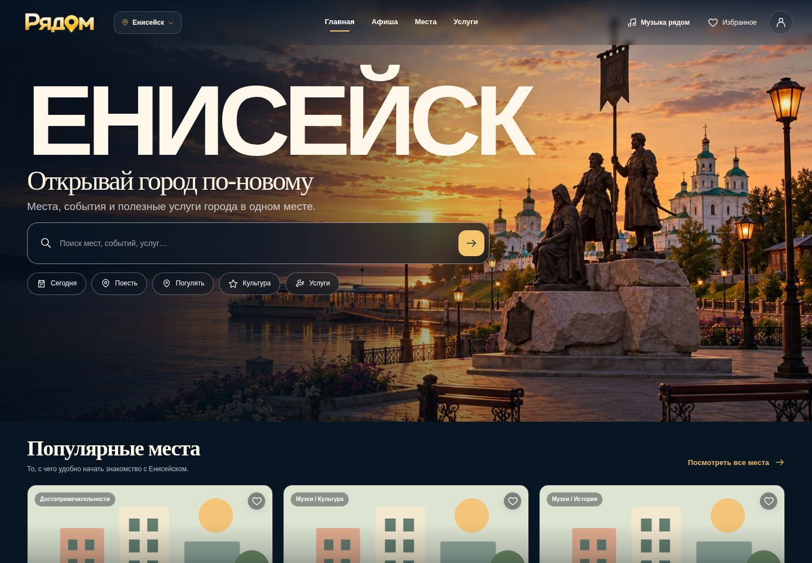
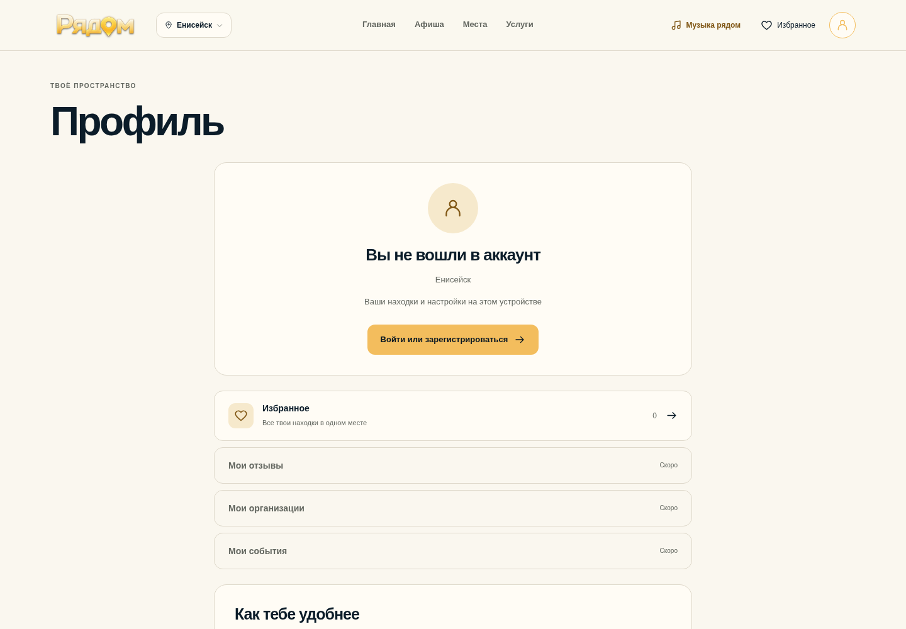
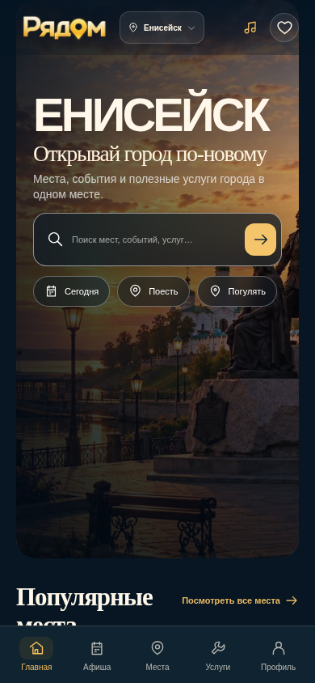
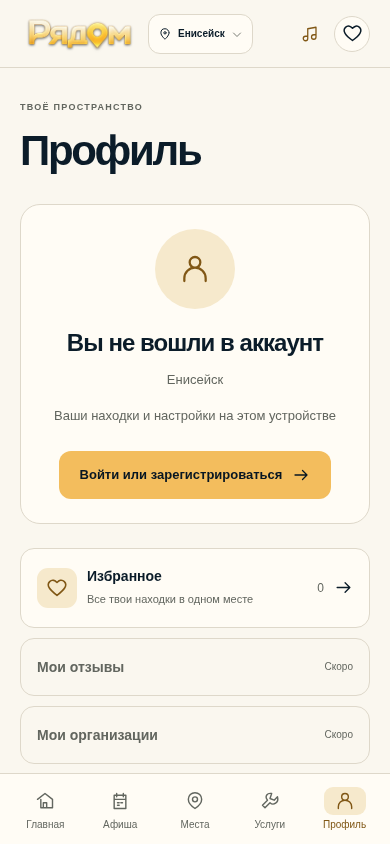

# Утверждённый логотип «Рядом»

Оригинал из предоставленного владельцем ZIP: `public/brand/ryadom-logo-transparent.png`.

- PNG RGBA, 2048 × 682 px, прозрачный фон.
- SHA-256 исходника и файла в репозитории: `c105b130e2f4fe3787b5a283ebb86eb2576d47983277d3593de53b3e9e02b2d6`.
- Изображение не перерисовывалось, не перекрашивалось и не перекодировалось. Шрифт, геометка, пропорции и исходные цвета сохранены.
- Все действующие фирменные логотипы используют `BrandWordmark`: desktop/mobile header, footer, profile, login/recovery и служебный CSV-importer.
- Логотип сохраняет пропорции через `height: auto`; URL учитывает Vite `BASE_URL`. В светлой теме применяется только небольшая внешняя CSS-тень для контраста, без изменения PNG и без фоновой подложки.
- Отдельное изображение имеет `alt="Рядом"`. В уже подписанных навигационных кнопках/ссылках изображение декоративное, чтобы название не повторялось для экранной читалки.
- Обычные текстовые упоминания, SEO, «ЕНИСЕЙСК», favicon, hero и бизнес-логика не изменены.

## Проверки

`npm ci`, `npm run lint`, `npm run build`, `npm run test` (51 тест), `git diff --check` — успешно.

Chromium/Playwright: 50 комбинаций главной, каталога, профиля, авторизации и importer, двух тем и ширин 320/390/768/1440/1920 px. Все изображения загрузились с исходными размерами и правильным соотношением сторон; нет обрезания, горизонтальной прокрутки или JavaScript-ошибок. Проверены доступные названия. Высота шапки главной сохранена: 68 px на телефоне, 76 px на планшете, 80 px на desktop.

390 px проверено в Chromium; реальное устройство iPhone/Safari в среде недоступно. Скриншоты сделаны локально с production-сборки, без реальной авторизации. Production не размещался.

## Скриншоты

| Desktop: главная, тёмная тема | Desktop: профиль, светлая тема |
| --- | --- |
|  |  |

| Mobile: главная, тёмная тема | Mobile: профиль, светлая тема |
| --- | --- |
|  |  |
