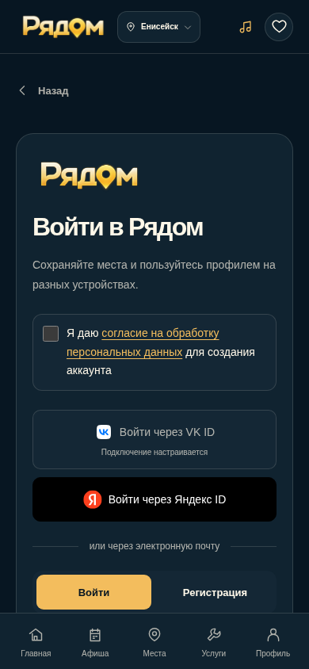
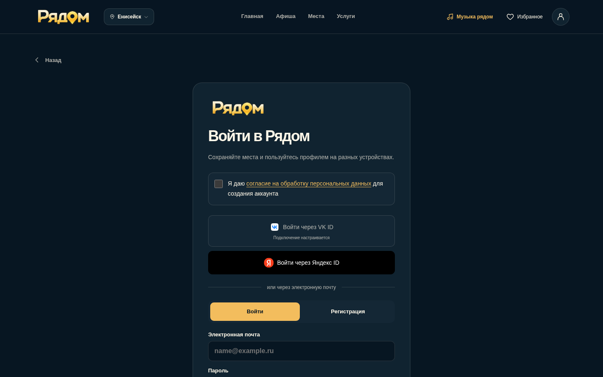

# Самостоятельный сайт и подготовка VK ID

Проект использует браузерные темы и адаптивную компоновку. Вход: email/пароль (с регистрацией и восстановлением), Яндекс ID и подготовленный VK ID, выключенный до серверной настройки и реального сквозного теста.

## Удалено

- src/telegram/sdk.ts: загрузчик SDK, определение запуска по URL/sessionStorage, ready/expand, тайм-аут SDK.
- src/hooks/useTelegram.ts: обработчики WebApp и тема по данным внешнего приложения. Вместо него src/hooks/useTheme.ts с prefers-color-scheme.
- src/auth/telegramIdentity.ts: неиспользуемая заготовка identity exchange.
- Типы WebApp, внешнего пользователя и Window declaration; native BackButton; переключение компоновки по среде запуска; отображение непроверенного имени/аватара.
- Кнопки Google, MAX и устаревшего способа входа; инструкции Mini App в текущей документации.

## Сохранено

Supabase client, AuthProvider, profiles, чтение user_identities, аккаунтное и гостевое избранное, RLS и схема БД. Исторические identity записи остаются читаемыми и показываются без активной кнопки как «Ранее привязанный способ входа». Никаких миграций и операций удаления данных нет. В Метрике сохранён фильтр приватных параметров старых ссылок: это очистка данных, а не интеграция SDK.

Главная, каталог организаций, афиша, услуги, поиск, OpenStreetMap/ссылки карт, музыка, маршруты и Escape, мобильная нижняя навигация, адаптивная шапка. Ранний скрипт и критические стили index.html из PR #33, золотой логотип и анимация PR #32 не изменены. Workflow Build Sprinthost ZIP не изменён.

## Файлы

- Тема и компоновка: src/hooks/useTheme.ts, src/App.tsx, src/pages/OrganizationImportPage.tsx, src/pages/ProfilePage.tsx, src/components/CityHome.tsx, src/types/index.ts.
- Вход и callbacks: src/pages/LoginPage.tsx, src/auth/providers.ts, src/auth/oauth.ts, src/auth/oauthCallback.ts, src/main.tsx, src/types/auth.ts, src/auth/adapter.ts, src/services/yandexProfile.ts.
- Стиль формы: src/styles/account.css, public/brand/vk-id.svg, public/brand/yandex-id.svg. Локальные оригинальные SVG взяты из [официального SDK VK](https://github.com/VKCOM/vkid-web-sdk/blob/master/src/widgets/oneTap/template.ts) и [Yandex UI](https://github.com/bem/yandex-ui/blob/master/src/Header/Logo/Logo.assets/rebrand/yandex-circle-ru.svg). Общий логотип Рядом не менялся. Рекомендации кнопок: [Яндекс ID](https://yandex.ru/dev/id/doc/ru/codes/buttons-design).
- Конфигурация и тесты: .env.example, src/vite-env.d.ts, package.json, tests/website-oauth.test.mjs.
- README.md и документация accounts, github-pages, organization-importer, theme-startup, startup-loading, seo-audit, technical-audit, visual-redesign; новые vk-id.md и этот отчёт. Убраны устаревшие инструкции и ссылки на удалённый код; имя репозитория и историческая совместимость БД сохранены.

## VK ID

Подготовлен настоящий вызов Supabase signInWithOAuth(custom:vk), сохранён вызов custom:yandex. Supabase управляет PKCE, state, проверкой callback и собственной сессией. Приложение не генерирует сессии и не связывает аккаунты по имени или неподтверждённому email.

VK ID требует device_id при обмене кода и особого POST userinfo. Поэтому прямое подключение стандартных endpoints к generic provider не подтверждено и не включено. Безопасная серверная архитектура, ограничения и пошаговые действия владельца: [vk-id.md](vk-id.md). Нужны VK web-приложение, совместимый server bridge, Supabase custom provider, корректные callback/redirect URL и сквозной тест. Bridge в этот PR не реализован и не развёрнут. Флаг VITE_VK_ID_ENABLED не заменяет серверный этап; по умолчанию false.

Отменённый/ошибочный callback переводит на LoginPage с безопасным фиксированным сообщением. Приватные callback параметры удаляются из адреса до аналитики; тексты от провайдера не отображаются. Успешные callbacks остаются в стандартном Supabase flow.

## Автоматические проверки

- npm run lint, npm run build, npm run test, git diff --check: PASS, 93 теста, включая 9 новых проверок OAuth/ошибок, отсутствия SDK-кода и исключения upstream provider tokens из сохраняемой сессии.
- Chromium production-сборка: 320, 390, 768, 900, 1440 px × светлая/тёмная тема. Смена system preference без перезагрузки; сохранение выбранной темы. Правильная desktop/mobile компоновка, 0 запросов SDK даже при имитации прежнего запуска, 0 необработанных JS-ошибок.
- Профиль/guest/login, согласие, избранное и повторная загрузка, детали и Escape, ссылки карт, афиша/услуги, музыкальные controls. Play/playing моделируется локальным media fixture; живой радиоэфир не проверен.
- Изолированные Supabase HTTP fixtures: email signup/signin, восстановление сессии, signout, исторические identities, account favorites, consent перед OAuth, custom:yandex/custom:vk с PKCE S256, отменённый и ошибочный callback. Fixtures не подключаются к рабочей БД и не доказывают действующий вход через провайдеров.
- Повторно 30 сценариев первого открытия без кеша и reload с задержкой JS/CSS: светлая/тёмная/system, JSON/обычное значение storage. В тёмных кадрах нет светлого фона. Геометка подпрыгивает; сохранены тайм-аут 20 секунд и восстановление кнопкой перезагрузки.

Реальные VK/Яндекс аккаунты, доставка/подтверждение email, действующая Supabase RLS, обновление сессии VK, объединение существующих способов входа и настоящая синхронизация между устройствами не проверены без внешнего тестового окружения. Safari/WebKit и физические iPhone/Android недоступны; мобильная проверка — Chromium touch-эмуляция. Production, DNS, хостинг и база не изменялись.

## Скриншоты

